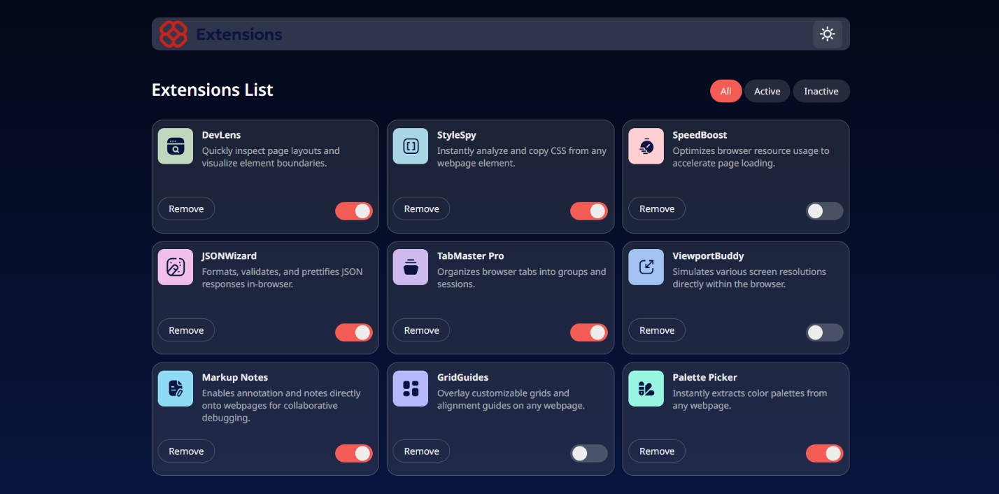
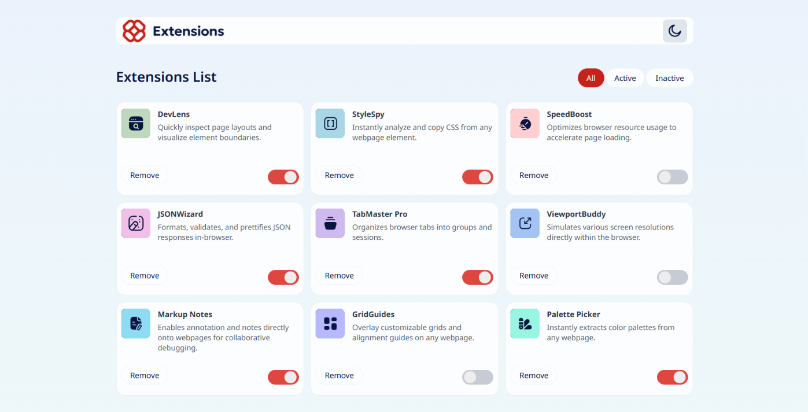

## Table of contents

- [Overview](#overview)
  - [The challenge](#the-challenge)
  - [Screenshot](#screenshot)
  - [Links](#links)
- [My process](#my-process)
  - [Built with](#built-with)
  - [What I learned](#what-i-learned)
- [Author](#author)

## Overview

### The challenge

Users should be able to:

- Toggle extensions between active and inactive states
- Filter active and inactive extensions
- Remove extensions from the list
- Select their color theme
- View the optimal layout for the interface depending on their device's screen size
- See hover and focus states for all interactive elements on the page

### Screenshot

### Links
- Solution URL: [solution URL here](https://www.frontendmentor.io/solutions/responsive-browser-extension-manager-ui-TMAX1m02al)
- Live Site URL: [live site URL here](https://unnati-chaudhari.github.io/Browser-extension-manager-ui/)

## My process

### Built with
- HTML
- CSS custom properties
- Flexbox
- CSS Grid

### What I learned
I learned the forEach function of javascript and more about flex box and grid and also more about media queries.

## Author

- Github - [@Unnati-Chaudhari](https://github.com/Unnati-Chaudhari)
- Frontend Mentor - [@Unnati-Chaudhari](https://www.frontendmentor.io/profile/Unnati-Chaudhari)
- X - [@aka_unnnn](https://x.com/aka_unnnn)